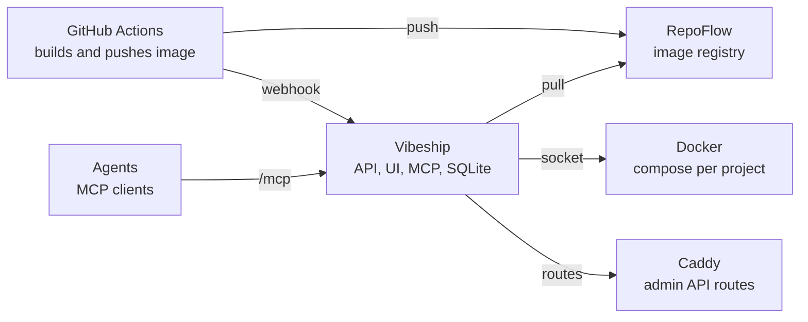

# Vibeship: project spec

A self-hosted deploy portal for vibe-coded apps: push to GitHub, images land in RepoFlow, and Vibeship deploys them with Caddy routes, through a web UI and an MCP endpoint for agents.

## Contents

1. [Goals and non-goals](#goals-and-non-goals)
2. [Architecture](#architecture)
3. [Host layout](#host-layout)
4. [Project types](#project-types)
5. [Deploy flow](#deploy-flow)
6. [Routing with Caddy](#routing-with-caddy)
7. [Auth and secrets](#auth-and-secrets)
8. [MCP endpoint](#mcp-endpoint)
9. [HTTP API](#http-api)
10. [Data model (SQLite)](#data-model-sqlite)
11. [Web UI](#web-ui)
12. [Bootstrap and packaging](#bootstrap-and-packaging)
13. [Local development and testing](#local-development-and-testing)
14. [MVP scope](#mvp-scope)

## Goals and non-goals

| | |
|---|---|
| Name | Vibeship |
| URL | `vibeship.hiranyey.dev` |
| Stack | Node 26 and TypeScript: Hono for the API and server-rendered HTML templates, one Docker image |
| Storage | Node's built-in `node:sqlite` with plain SQL, no ORM or query builder |
| Login | OIDC with Clerk (`clerk.hiranyey.dev`), same as hisaab |
| Agents | MCP over Streamable HTTP at `/mcp` with scoped API tokens |

Goals:

- Deploy RepoFlow images built by GitHub Actions, triggered by a webhook.
- Create and edit docker compose projects in the UI for things not in GitHub or RepoFlow.
- Give every project its own folder, container, hostname and Caddy route automatically.
- Keep infrastructure simple: a few seconds of downtime during a deploy is accepted, but a broken version never stays live.
- Let any agent list, create, deploy and debug projects through MCP.

Non-goals: no Cloudflare DNS changes (the `*.hiranyey.dev` wildcard already points at this VM), no notifications (status lives in the UI and deploy logs), no multi-host, and no building images on the VM.

## Architecture

One Node process serves the UI, the HTTP API, the webhook receiver and the MCP endpoint. All four call the same service layer, so a deploy from an agent, a webhook or a button runs the same code and lands in the same audit log. A single in-process queue serializes deploys per project; the `deploys` table is its durable record, so a restart can recover it (see [Deploy flow](#deploy-flow)).

## Host layout

| Path | Contents |
|---|---|
| `/opt/stack/caddy/` | `compose.yaml`, `Caddyfile`, `data/`, `config/`, Cloudflare origin certs |
| `/opt/stack/vibeship/` | `compose.yaml`, `.env` (mode 600, holds `MASTER_KEY`), `data/vibeship.db` |
| `/opt/stack/<project>/` | `compose.yaml`, `.env`, `data/`, all generated from the database |

Two external Docker networks exist:

| Network | Members | Purpose |
|---|---|---|
| `web` | Caddy, Vibeship, the routed container of every project | Caddy proxies to apps |
| `caddy-admin` | Caddy and Vibeship only (`internal: true`) | Caddy admin API |

Each project's routed container joins `web` with the network alias `<project>`, so Caddy always reaches it as `<project>:<port>` whatever the service is called inside the compose file. Only the routed service joins `web`; a project's other services (databases, workers) stay on that project's default compose network, so two projects can both have a service called `db` or `app` without clashing. Project names are unique slugs, and `caddy`, `caddy-api`, `caddy-admin`, `vibeship`, `web` and `localhost` are reserved so no alias can shadow them. Compose also adds the service name as an alias on every network a service joins, so a compose project's routed service may not use a reserved name either; otherwise a service called `vibeship` could take some of Caddy's traffic for the Vibeship UI. No container publishes a port on `0.0.0.0`: only Caddy listens publicly on 443, and any other published port is bound to `127.0.0.1`. Generated files are a cache of the database: Vibeship rewrites them on every deploy, and a hand edit is flagged as drift in the UI. Drift compares each file with the hash recorded when it was written, so it is told apart from database changes (such as a new env var) not yet deployed. An image project's container mounts its `data/` folder at `/data`.

## Project types

| | Image project | Compose project |
|---|---|---|
| Source | RepoFlow image ref, e.g. `.../library/server:latest` | Compose YAML written in the UI or via MCP |
| Trigger | Webhook, deploy button, MCP `deploy` | Save and deploy, MCP `deploy` |
| Version | Image digest | Numbered `compose_versions` row |
| Compose file | Generated from a template | User YAML, validated and patched |
| Route | Hostname plus container port | Hostname plus service and port |

For compose projects Vibeship checks the YAML against an allowlist when it is saved, then at deploy writes it out again from the parsed value (never the user's text), forces the project name, and attaches the routed service to `web` with the `<project>` alias; `docker compose config` checks the result before anything starts. The routed service is renamed to the project name in the written file, keeping its own name as an alias on the project's own networks, so whatever it is called it can't shadow Caddy, Vibeship or another project on `web`. Validation is an allowlist, not a denylist, because Vibeship holds the Docker socket and a permissive compose file amounts to root on the host:

- Allowed service keys: `image`, `command`, `entrypoint`, `environment`, `env_file` (the project's `.env` only), `ports` (bound to `127.0.0.1` only), `volumes`, `depends_on`, `healthcheck`, `restart`, `working_dir`, `user`, `labels`, `mem_limit`, `cpus`, `networks` (project networks only).
- Volumes must be bind mounts of the project's `./data` folder itself or plain named volumes with no `driver`, `driver_opts`, `name` or `external`. Paths inside `data/` are refused, because a container could plant a symlink there that a later deploy would follow out to the host.
- Allowed top-level keys: `services`, `volumes`, `networks` (with no external networks other than `web`, which Vibeship adds itself). `version` and `x-` blocks are accepted and dropped.
- `$` (variable interpolation) is refused in `volumes`, `ports` and `networks`, since compose resolves it after the check. Elsewhere it is allowed and filled in from the project's `.env` only: `docker` runs with a minimal environment, so `MASTER_KEY` can't be interpolated, and env var names starting with `COMPOSE_` or `DOCKER_` are refused because compose reads those as its own settings.
- Anything else is rejected with the offending key named, including `privileged`, `network_mode`, `pid`, `ipc`, `cap_add`, `devices`, `security_opt`, `userns_mode`, `build` and `extends`.

## Deploy flow

1. **Trigger**: a POST to the project's webhook URL with the image digest, or a UI or MCP call. A deploy row is created as queued.
2. **Pull**: pull the image by digest from RepoFlow with a read-only token. Compose projects run `docker compose pull`.
3. **Render**: write `compose.yaml` and `.env` from the database into the project folder.
4. **Start**: `docker compose -p <project> up -d`, streaming output into `deploy_logs`. This replaces the running container in place, so the app is briefly down; that is accepted.
5. **Health check**: poll the health path or wait for the container to stay running, with a timeout (default 60 s).
6. **Route**: on success, upsert the Caddy route (needed on first deploy or a hostname change) and mark the deploy healthy with its digest as current.
7. **Fail safe**: on failure, re-render the last healthy version, bring it back, and mark the deploy failed with logs kept.

**Recovery after a restart.** The queue lives in memory, so on boot, before accepting requests, Vibeship scans `deploys`:

- A deploy left `running` is marked `failed` with the reason `interrupted by restart`. Vibeship then checks the project's container; unless it is running the last healthy image and not reporting unhealthy, a `recovery` deploy of the last healthy digest is queued. If the project never had a healthy version, its container is stopped and the project marked failed. A recovery deploy that fails is not retried.
- Deploys left `queued` run in their original order once the project's recovery deploy has finished. The `deploys` table is the queue, so nothing needs re-enqueuing; a claim on each row is atomic, so a deploy never runs twice.
- Each recovery action writes an `audit_log` row with actor `system`.

## Routing with Caddy

Caddy runs as its own container with its admin API listening on port 2019 only on the internal `caddy-admin` network, which only Caddy and Vibeship join. Project containers share `web` with Caddy but cannot reach the admin API, so a compromised app cannot rewrite routes. Caddy gets a fixed address on `caddy-admin` (`172.31.250.2`, from the `172.31.250.0/24` subnet the network is created with) and binds the admin API to that address only; Vibeship calls it as `http://caddy-api:2019`, an alias that exists only on `caddy-admin`, and Caddy's `admin.origins` allows only that host. Vibeship owns one server block (`vibeship`) and manages a route per hostname by `@id` (`vs-route-<id>`), so a change touches one route and is validated by Caddy before it applies. Managed routes go ahead of the base config's own routes, which end with a catch-all that answers 404 for hostnames with no app. Caddy starts from its base config alone, so Vibeship reconciles every route from the database on boot and every 10 seconds after: a restarted Caddy is rebuilt within one interval, and a hostname change in the database reaches Caddy the same way. A route exists only once a project has a healthy version. TLS uses the Cloudflare origin certificate for `*.hiranyey.dev` with Cloudflare proxying in front.

## Auth and secrets

- Browser login is OIDC authorization code with PKCE against Clerk. The Clerk app has a single user and signup disabled, so anyone who completes the login is the admin. As a second check, Vibeship only accepts the verified emails in `ADMIN_EMAILS` (bootstrap requires it), so a Clerk misconfiguration alone doesn't hand out the server; refused logins are audited as `auth.refused`.
- Sessions are random tokens in an HttpOnly, Secure, SameSite=Lax cookie, stored hashed in `sessions`.
- Agents use bearer API tokens created in the UI, shown once, stored as SHA-256 hashes, with scope read, deploy or admin and an optional expiry.
- Env values and registry tokens are encrypted with AES-256-GCM using `MASTER_KEY`, 32 random bytes in base64 set in Vibeship's `.env` (generate one with `npm run gen-key`). Keep a copy outside the VM, such as in a password manager: without it, stored secrets cannot be decrypted. Secret values are write-only in the UI and MCP.
- Each image project has its own webhook URL, `https://vibeship.hiranyey.dev/hooks/deploy/<token>`, where the token is 32 random bytes in base64url. It is shown once when generated, stored as a SHA-256 hash on the project, and can be rotated in the UI, which invalidates the old URL. The token identifies the project, so the request body carries only the digest, and Vibeship rejects a digest that does not belong to the project's `image_ref` repository. A replayed request can only redeploy a digest already pushed, which is harmless. Caddy's access log for `vibeship.hiranyey.dev` drops the `/hooks/` path so tokens are not written to disk.
- A deploy-scope token can create and change compose projects; the compose allowlist in [Project types](#project-types) is what stops that from becoming host root.
- Every change writes an `audit_log` row naming the user or the token.

## MCP endpoint

| Tool | Scope | What it does |
|---|---|---|
| `list_projects` | read | All projects with kind, hostname and status |
| `get_project` | read | Config, route, env keys (no secret values), current version |
| `get_status` | read | Live container state from Docker |
| `list_deploys` | read | Recent deploys for a project |
| `get_deploy_logs` | read | Log lines for one deploy |
| `get_container_logs` | read | Tail of a container's logs |
| `create_project` | deploy | New image or compose project with hostname |
| `update_project` | deploy | Change the hostname, or an image project's image, port or health path |
| `update_compose` | deploy | Save a new compose version |
| `set_env` | deploy | Set or unset env vars and secrets |
| `deploy` | deploy | Deploy latest, a digest or a compose version; returns a deploy id |
| `restart`, `stop`, `start` | deploy | Container lifecycle |
| `delete_project` | admin | Remove containers, route and rows; keeps `data/` unless asked |

The endpoint uses `@modelcontextprotocol/sdk` over Streamable HTTP at `https://vibeship.hiranyey.dev/mcp`, authenticated with `Authorization: Bearer <token>`; a browser session cookie is not accepted. It is stateless: every tool returns at once, so each POST gets a plain JSON reply and there are no sessions. A token is only shown the tools its scope allows. `deploy` returns at once with a deploy id, and the agent follows progress with `get_deploy_logs` and `get_status`.

## HTTP API

| Route | Purpose |
|---|---|
| `GET /api/projects`, `POST /api/projects` | List and create projects |
| `GET\|PATCH\|DELETE /api/projects/:id` | Read, edit and delete one project |
| `PUT /api/projects/:id/env` | Replace env vars |
| `GET\|POST /api/projects/:id/compose` | List compose versions, or save a new one |
| `POST /api/projects/:id/deploy` | Start a deploy |
| `GET /api/projects/:id/status`, `POST /api/projects/:id/{stop,start,restart}` | Live container state and lifecycle |
| `GET /api/deploys/:id/logs` | Deploy logs, streamed with server-sent events |
| `GET /api/projects/:id/logs` | Container logs, streamed |
| `POST /api/projects/:id/webhook` | Generate or rotate the project's webhook URL (shown once) |
| `POST /hooks/deploy/:token` | Per-project webhook from GitHub Actions |
| `/auth/login`, `/auth/callback`, `/auth/logout` | OIDC flow |
| `/api/tokens` | Create, list and revoke API tokens |

Request bodies are validated with Zod schemas shared by the API and the MCP tools.

## Data model (SQLite)

| Table | Key columns |
|---|---|
| `users` | id, oidc_sub, email, name, role, created_at, last_login_at |
| `sessions` | id (hash), user_id, expires_at, ip, user_agent |
| `api_tokens` | id, name, token_hash, scope, project_ids, created_by, last_used_at, expires_at, revoked_at |
| `projects` | id, name (slug), kind, hostname, status, webhook_token_hash, created_by, timestamps |
| `image_sources` | project_id, registry_id, image_ref, container_port, health_path, mem_limit, current_digest |
| `compose_versions` | id, project_id, version, compose_yaml, routed_service, port, note, created_by |
| `routes` | id, project_id, hostname, upstream, options (JSON) |
| `env_vars` | project_id, key, value_encrypted, is_secret, updated_by, updated_at |
| `registries` | id, name, url, username, token_encrypted |
| `deploys` | id, project_id, trigger, digest or compose_version_id, status (queued, running, healthy, failed), failure_reason, actor, started_at, finished_at |
| `deploy_logs` | deploy_id, seq, ts, stream, line |
| `audit_log` | id, actor_type, user_id, token_id, action, target, details (JSON), ip, ts |
| `settings` | key, value: health timeout (the base domain comes from `BASE_DOMAIN`) |
| `rendered_files` | project_id, path, sha256, written_at: what Vibeship last wrote, to detect hand edits |

Access goes through `DatabaseSync` from `node:sqlite` with hand-written SQL and prepared statements. WAL mode is on, numbered `.sql` migrations run on boot, and live container state is never stored; the UI reads it from Docker.

## Web UI

- Dashboard: every project with status, hostname, current version and last deploy.
- Project page with tabs for overview, deploys, logs, env, compose (with a YAML editor and version history) and settings.
- New project wizard: pick image or compose, set name, hostname, port and env.
- Deploy view with live streamed logs.
- Settings for registries, API tokens and the audit log.

Pages are rendered on the server by Hono with HTML templates from `hono/html`, laid out like Arcane (a sidebar, dense tables, status pills) in the Ink & Grid theme with one plain CSS file: a cream sidebar beside white content, flat surfaces, 2px ink borders on key containers, corners rounded about 6px (4px on small chips), monospace for digests, hostnames and logs, and signal orange `#e85d04` for primary actions and the running status (`#b45309` for orange text on white). A little vanilla JS streams live logs over server-sent events, and there is no frontend build step. The design system lives in `vibeship.css` and `design-system.html`; the pages themselves are in `src/ui/`.

## Bootstrap and packaging

`scripts/bootstrap.sh` sets up a fresh Debian server and is safe to run again (it is also how Vibeship is updated, after `git pull`). The steps are in [PRODUCTION.md](PRODUCTION.md); in short:

1. **Install Docker**: Docker Engine and the compose plugin from Docker's apt repository, unattended security updates, and container logs capped at 5 × 10 MB.
2. **Networks and folders**: create the `web` network, the internal `caddy-admin` network, and `/opt/stack/{caddy,vibeship}`.
3. **Caddy**: copy in the Cloudflare origin certificate (checked against its key and `*.BASE_DOMAIN` before it replaces anything), write `caddy.json` from `src/caddy/base-config.ts` (TLS on :443 only, no ACME, no HTTP/3, admin API bound to the `caddy-admin` network only) and `deploy/caddy/compose.yaml`. Caddy restarts only when its config or certificate changed.
4. **Vibeship**: build the image from the checkout, write `.env` with mode 600 (OIDC settings, `ADMIN_EMAILS`, and a newly generated `MASTER_KEY`, unless one is passed in to restore an existing database; an existing key is never replaced), and start `deploy/vibeship/compose.yaml` with no published port; Caddy routes `vibeship.hiranyey.dev` to it.
5. **Firewall**: ufw allows only SSH and 443. With `CLOUDFLARE_ONLY=1`, 443 is limited to Cloudflare's ranges in ufw and in Docker's `DOCKER-USER` chain, since ports Docker publishes bypass ufw's own rules.

The image is built on `node:26-slim` with the Docker CLI and compose plugin. It mounts `/var/run/docker.sock` and binds `/opt/stack` at the same path, because compose resolves relative bind mounts against host paths. Vibeship never redeploys itself; it is updated by hand. The repo ships a sample GitHub Actions workflow, `examples/github-actions/deploy.yml`, that builds, pushes to RepoFlow and POSTs the digest to the project's webhook URL, kept as a repository secret.

## Local development and testing

The whole stack runs on a laptop with Docker Desktop or OrbStack. Nothing in the code hardcodes the production host; these settings come from `.env`:

| Setting | Production | Local |
|---|---|---|
| `STACK_ROOT` | `/opt/stack` | `<repo>/.dev/stack` (an absolute path, bound at the same path in the container) |
| `BASE_DOMAIN` | `hiranyey.dev` | `localhost`, so apps live at `<project>.localhost`, which browsers and curl resolve to 127.0.0.1 with no DNS setup |
| `TLS_MODE` | `origin-cert` | `off` (Caddy serves plain HTTP on `127.0.0.1:8080`) |
| `OIDC_*` | Clerk production instance | Clerk development instance with `http://vibeship.localhost:8080/auth/callback` as the redirect |
| Registry | RepoFlow | `registry:3` on `localhost:5050` standing in for RepoFlow (5000 is taken by AirPlay on macOS) |

`compose.dev.yaml` starts Caddy, the local registry and Vibeship with its source mounted and `node --watch`, on the same `web` and `caddy-admin` networks as production. `npm run dev` brings it up. Because local runs the same networks, Caddy admin API and Docker socket as production, most bugs show up on the laptop first.

**Fixture apps.** `examples/` holds small images that `npm run fixtures` builds and pushes to the local registry:

- `hello`: serves 200 on `/health`.
- `crash`: exits right after starting.
- `unhealthy`: runs but returns 500 on `/health`.
- `probe`: tries to reach `caddy:2019` and other projects, and reports what it reached.
- `compose-two-apps`: two compose projects that both have services named `app` and `db`.

`scripts/webhook.sh <webhook-url> <image>` resolves the digest from the local registry and POSTs it the way the GitHub Actions workflow would. Running the real workflow locally with `act` is optional.

**Test layers**, all on the built-in `node:test` runner:

1. **Unit** (`npm test`, no Docker needed): the compose allowlist validator (a table of good and malicious YAML, including every rejected key), webhook token hashing and digest-to-repo matching, AES-GCM env encryption, Zod schemas, and migrations against an in-memory `:memory:` database. The deploy state machine is tested through a `DockerRunner` interface with a fake implementation, which lets tests simulate a crash, a timeout or an unhealthy container.
2. **Integration** (`npm run test:integration`, needs the dev stack running): runs the real flows against real Docker and Caddy, and tears the projects down afterwards:
   - Deploying `hello` through the webhook makes `hello.localhost:8080` return 200.
   - Deploying `crash` or `unhealthy` over `hello` fails, and `hello` is serving again afterwards.
   - Killing the Vibeship container mid-deploy and starting it again marks that deploy `failed` (`interrupted by restart`), restores the last healthy version and runs any queued deploys.
   - `probe` cannot reach `caddy:2019`.
   - Both `compose-two-apps` projects route correctly through their `<project>` aliases.
   - A rotated webhook URL returns 404 for the old token.
3. **MCP**: the integration suite drives `/mcp` with the SDK client using a deploy-scope token. To poke at it by hand, point MCP Inspector (`npx @modelcontextprotocol/inspector`) at `http://vibeship.localhost:8080/mcp`, or run `claude mcp add --transport http vibeship-dev http://vibeship.localhost:8080/mcp --header "Authorization: Bearer <token>"`.
4. **Bootstrap**: `bootstrap.sh` is tested on a throwaway Debian VM (OrbStack, Lima or Multipass), checking that it is idempotent when run twice and that only 22 and 443 are open afterwards.

## MVP scope

**In the MVP**

- Clerk login, single admin (with an `ADMIN_EMAILS` check)
- Image and compose projects
- Generated folders and Caddy routes
- Encrypted env vars
- Webhook and manual deploys
- Health-checked deploys with fail safe
- Deploy and container logs
- MCP with scoped API tokens
- Audit log
- Bootstrap script
- Local dev stack, fixture apps, unit and integration tests

**Later**

- Viewer role and per-project token allowlists
- Registry polling fallback
- Rollback button and MCP tool
- Snapshots of `data/` and off-VM backups
- Automatic image pruning
- Multiple registries and routes per project
- CPU and memory graphs
- UI polish beyond functional pages

**Done means:** a push to a repo with the sample workflow goes live at its subdomain within a couple of minutes, a broken image is replaced by the previous version once its health check fails, and an agent with a deploy token can create, deploy and debug a project through MCP alone.
